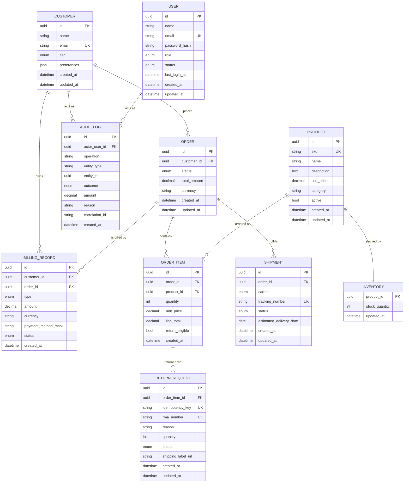

# Data Model — csr-naive-agent (corrected)

**Status**: Draft · **Last Updated**: 2026-11-08
**Purpose**: Defines entities, fields, relationships, and constraints for the domain layer. Keeps the domain free of FastAPI/Streamlit/SQLAlchemy types (AD-1, AD-3). Concrete tables are produced by SQLAlchemy adapters in `infrastructure/repositories/`.

## 1. Entity-Relationship Diagram

> Note: a Mermaid `uuid`/`enum`/`json`/`text` type is illustrative; the domain uses plain Python types (`uuid.UUID`, `str`, `Decimal`, `datetime`, `Enum`) — no ORM imports (AD-3).

## 2. Entities

### Customer
| Field | Type | Constraints |
|-------|------|-------------|
| id | UUID | PK |
| name | str | required |
| email | str | required, **unique**, valid format |
| tier | Enum(`Standard`,`Gold`,`Enterprise`) | required |
| preferences | JSON | optional, default `{}` |
| created_at / updated_at | datetime | ISO 8601, UTC |

> **Resolves** the "Maximum 5 tier levels vs 3 predefined tiers" conflict: tiers are exactly the three enum values. If more tiers are ever needed, add them to the enum, not a "max 5" rule.

### Product (new — was missing)
| Field | Type | Constraints |
|-------|------|-------------|
| id | UUID | PK |
| sku | str | **unique** |
| name | str | required |
| description | text | optional |
| unit_price | Decimal | > 0 |
| category | str | optional |
| active | bool | default true |
| created_at / updated_at | datetime | ISO 8601 |

> Required by every order flow in EXPERIENCE.md; previously absent from the domain model.

### Inventory (new — was missing)
| Field | Type | Constraints |
|-------|------|-------------|
| product_id | UUID | PK, FK → Product |
| stock_quantity | int | >= 0 |
| updated_at | datetime | ISO 8601 |

> Update the "insufficient inventory" error path to check `stock_quantity`. Reservation/backorder logic is deferred.

### Order
| Field | Type | Constraints |
|-------|------|-------------|
| id | UUID | PK |
| customer_id | UUID | FK → Customer, required |
| status | Enum(`Processing`,`Completed`,`Returned`,`Cancelled`) | default `Processing`; transitions enforced in domain |
| total_amount | Decimal | >= 0, derived from items |
| currency | str | ISO 4217, default `USD` |
| created_at / updated_at | datetime | ISO 8601 |

### OrderItem
| Field | Type | Constraints |
|-------|------|-------------|
| id | UUID | PK |
| order_id | UUID | FK → Order |
| product_id | UUID | FK → Product |
| quantity | int | >= 1 |
| unit_price | Decimal | > 0 (price snapshot at order time) |
| line_total | Decimal | = quantity × unit_price |
| return_eligible | bool | set by FR-09; default false |
| created_at | datetime | ISO 8601 |

> **Resolves** the "quantity 1–5" ambiguity: default rule is `quantity >= 1`. If a per-line cap is wanted, make it configurable (e.g., `MAX_QTY_PER_LINE`), not a hidden UI rule.

### Shipment
| Field | Type | Constraints |
|-------|------|-------------|
| id | UUID | PK |
| order_id | UUID | FK → Order |
| carrier | Enum(`FedEx`,`UPS`,`DHL`) | required (USPS removed to match PRD; add only if PRD updated) |
| tracking_number | str | **unique per shipment** |
| status | Enum(`Label Created`,`In Transit`,`Out for Delivery`,`Delivered`) | transitions enforced |
| estimated_delivery_date | date | optional |
| created_at / updated_at | datetime | ISO 8601 |

### BillingRecord
| Field | Type | Constraints |
|-------|------|-------------|
| id | UUID | PK |
| customer_id | UUID | FK → Customer |
| order_id | UUID | FK → Order, nullable |
| type | Enum(`Charge`,`Refund`,`Credit`) | required |
| amount | Decimal | > 0 |
| currency | str | ISO 4217 |
| payment_method_mask | str | e.g. `"Visa ending in 4242"`; **never** full PAN (AD-4) |
| status | Enum(`Pending`,`Completed`,`Failed`) | default `Pending` |
| created_at | datetime | ISO 8601 |

> Customer balance is **derived**: `sum(Charge) − sum(Refund) − sum(Credit)`. Do not store a mutable `balance` column (avoids drift). If a stored balance is required for performance, add a ledger reconciliation job.

### ReturnRequest (new — was missing)
| Field | Type | Constraints |
|-------|------|-------------|
| id | UUID | PK |
| order_item_id | UUID | FK → OrderItem |
| idempotency_key | str | **unique** — prevents duplicate submissions (FR-26) |
| rma_number | str | **unique**, generated |
| reason | str | required, enumerated values |
| quantity | int | >= 1, <= OrderItem.quantity |
| status | Enum(`Submitted`,`Approved`,`Rejected`,`Completed`) | default `Submitted` |
| shipping_label_url | str | nullable until generated |
| created_at / updated_at | datetime | ISO 8601 |

> Return window (e.g., 30 days) is a **domain policy parameter**, not an entity field. Store the policy value in config so FR-25 stays deterministic.

### User
| Field | Type | Constraints |
|-------|------|-------------|
| id | UUID | PK |
| name | str | required |
| email | str | **unique**, valid format |
| password_hash | str | bcrypt/Argon2 only (AD-6); never plaintext |
| role | Enum(`Viewer`,`Operator`,`Manager`,`Administrator`,`User Manager`) | required |
| status | Enum(`active`,`inactive`) | default `active` |
| last_login_at | datetime | nullable |
| created_at / updated_at | datetime | ISO 8601 |

> Role set now includes `User Manager` so FR-29 matches RBAC.

### AuditLog (new — was missing as a model)
| Field | Type | Constraints |
|-------|------|-------------|
| id | UUID | PK |
| actor_user_id | UUID | FK → User, required |
| operation | str | e.g. `issue_refund`, `create_user`, `delete_user` |
| entity_type | str | e.g. `BillingRecord`, `User` |
| entity_id | UUID | target id |
| outcome | Enum(`success`,`failure`) | required |
| amount | Decimal | nullable, for monetary ops |
| reason | str | nullable |
| correlation_id | str | required, ties to request log |
| created_at | datetime | ISO 8601, append-only |

> Covers AD-5 and NFR 6.3. Immutable/append-only; no update/delete path.

## 3. Cross-Cutting Constraints

| Constraint | Applies to |
|-----------|-----------|
| Unique email | Customer, User |
| Unique tracking number | Shipment |
| Unique RMA number | ReturnRequest |
| Unique idempotency key | ReturnRequest |
| amount > 0 | OrderItem.unit_price, BillingRecord.amount |
| currency consistency | Order, BillingRecord |
| No full PAN stored | BillingRecord.payment_method_mask only |
| Append-only | AuditLog |

## 4. Mapping to Architecture Layers

| Concern | Layer |
|---------|-------|
| Entities above (plain Python) | `domain/entities.py` |
| Repository interfaces (read/write) | `domain/ports/` |
| Use cases (create_order, issue_refund, create_return_request, …) | `application/use_cases/` |
| SQLAlchemy models + repositories | `infrastructure/repositories/` |
| Carrier adapters | `infrastructure/carriers/` |
| Billing gateway adapters | `infrastructure/billing/` |
| Auth (JWT, hashing) | `infrastructure/auth/` |
| FastAPI routes + scope deps | `api/` |

## 5. Remaining Open Decisions

1. **FR-31 / FR-32** — define or renumber (affects nothing in this model yet).
2. **Carrier integration** — live API vs mock adapter for MVP; model unchanged, adapter differs.
3. **Quantity cap** — keep `>= 1` or add a configurable per-line max.
4. **Stored balance** — derived (recommended) or materialized with reconciliation.
5. **Notification email** — deferred; `shipping_label_url` is a placeholder until then.
